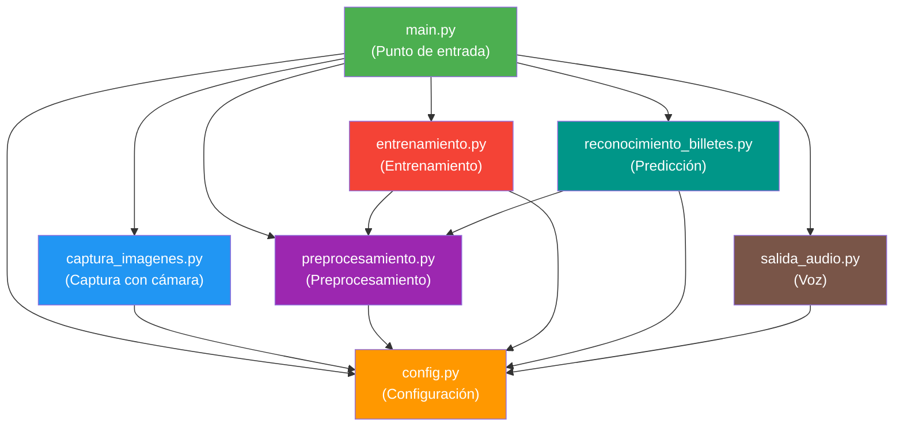
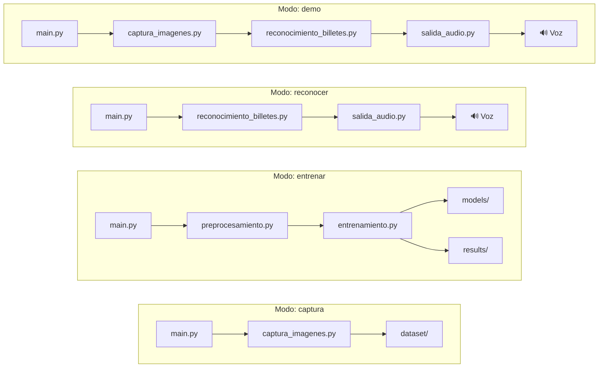

# NAYVO — Función de Cada Archivo

## Referencia completa de todos los archivos del proyecto

---

## 1. Tabla de Referencia de Archivos

### Archivos de código fuente (`src/`)

| Archivo | Función | Entradas | Salidas | Dependencias | Estado |
|---|---|---|---|---|---|
| `src/main.py` | Punto de entrada principal. Analiza argumentos de línea de comandos y dirige la ejecución al módulo correspondiente según el modo seleccionado. | Argumentos CLI (`--mode`, `--imagen`, `--denominacion`) | Ejecuta el modo correspondiente | `config.py`, `captura_imagenes.py`, `preprocesamiento.py`, `entrenamiento.py`, `reconocimiento_billetes.py`, `salida_audio.py` | Implementado (pendiente de pruebas) |
| `src/config.py` | Configuración central del proyecto. Define rutas de directorios, parámetros del modelo, clases de billetes, hiperparámetros de entrenamiento y umbrales. | Ninguna (archivo de constantes) | Constantes y parámetros de configuración | Ninguna | Implementado (pendiente de pruebas) |
| `src/captura_imagenes.py` | Captura fotografías de billetes usando la cámara web. Permite al usuario tomar fotos interactivamente y las guarda organizadas por denominación. | Denominación del billete, señal de captura (tecla) | Imágenes JPG guardadas en `dataset/billetes_mexicanos/imagenes_originales/{denominacion}/` | `config.py`, `cv2` (OpenCV) | Implementado (pendiente de pruebas) |
| `src/preprocesamiento.py` | Preprocesa las imágenes del dataset: redimensiona a 224×224, normaliza valores de píxeles, aplica aumento de datos (data augmentation), y divide en conjuntos de entrenamiento/validación/prueba. | Imágenes originales del dataset | Imágenes preprocesadas, datasets divididos, generadores de datos | `config.py`, `cv2`, `numpy`, `tensorflow.keras`, `sklearn` | Implementado (pendiente de pruebas) |
| `src/entrenamiento.py` | Construye el modelo MobileNetV2 con transfer learning, ejecuta el entrenamiento con los datos preprocesados, y guarda el modelo entrenado y las gráficas de resultados. | Datos preprocesados (de `preprocesamiento.py`) | Modelo `.keras` en `models/`, gráficas en `results/` | `config.py`, `preprocesamiento.py`, `tensorflow.keras`, `matplotlib`, `sklearn` | Implementado (pendiente de pruebas) |
| `src/reconocimiento_billetes.py` | Carga el modelo entrenado y realiza predicciones sobre imágenes nuevas. Retorna la denominación detectada y el nivel de confianza. | Imagen de billete (archivo o cuadro de cámara) | Denominación predicha, porcentaje de confianza | `config.py`, `preprocesamiento.py`, `tensorflow.keras`, `numpy` | Implementado (pendiente de pruebas) |
| `src/salida_audio.py` | Convierte el resultado de la predicción en voz sintetizada. Anuncia la denominación del billete detectado o un mensaje de error si la confianza es baja. | Denominación (string), confianza (float) | Audio por las bocinas del sistema | `config.py`, `pyttsx3` | Implementado (pendiente de pruebas) |

### Archivos de pruebas (`tests/`)

| Archivo | Función | Qué prueba | Estado |
|---|---|---|---|
| `tests/test_config.py` | Pruebas unitarias para la configuración | Que las constantes existan, que las rutas sean válidas, que las clases estén correctas | Implementado (pendiente de pruebas) |
| `tests/test_preprocesamiento.py` | Pruebas para el preprocesamiento | Que las imágenes se redimensionen correctamente, que la normalización funcione | Implementado (pendiente de pruebas) |
| `tests/test_reconocimiento.py` | Pruebas para el reconocimiento | Que el modelo cargue correctamente, que las predicciones tengan el formato esperado | Implementado (pendiente de pruebas) |
| `tests/test_salida_audio.py` | Pruebas para la salida de audio | Que el motor de voz se inicialice, que los mensajes sean correctos | Implementado (pendiente de pruebas) |

### Archivos de configuración (raíz)

| Archivo | Función | Estado |
|---|---|---|
| `requirements.txt` | Lista de dependencias de Python con versiones mínimas. Se usa con `pip install -r requirements.txt`. | ✅ Creado |
| `.gitignore` | Define qué archivos NO deben subirse al repositorio Git (entorno virtual, dataset de imágenes, modelos entrenados, cachés). | ✅ Creado |
| `README.md` | Descripción general del proyecto para la página principal del repositorio. | ✅ Creado |

### Documentación (`docs/`)

| Archivo | Contenido | Estado |
|---|---|---|
| `docs/01_descripcion_del_proyecto.md` | Descripción completa del proyecto, propósito, alcance y tecnologías | ✅ Creado |
| `docs/02_funcionamiento_del_sistema.md` | Cómo funciona el sistema técnicamente, flujo de datos, diagramas | ✅ Creado |
| `docs/03_instalacion_y_ejecucion.md` | Guía paso a paso de instalación y ejecución | ✅ Creado |
| `docs/04_funcion_de_cada_archivo.md` | Este documento: referencia de todos los archivos | ✅ Creado |
| `docs/05_entrenamiento_modelo.md` | Guía completa para entrenar el modelo de IA | ✅ Creado |

### Directorios de datos

| Directorio | Contenido | Estado |
|---|---|---|
| `dataset/billetes_mexicanos/imagenes_originales/` | Fotos sin procesar organizadas por denominación (6 subcarpetas) | ✅ Carpetas creadas (vacías) |
| `dataset/billetes_mexicanos/procesadas/` | Imágenes después del preprocesamiento | ✅ Carpeta creada (vacía) |
| `dataset/billetes_mexicanos/anotaciones/` | Metadatos del dataset | ✅ Carpeta creada (vacía) |
| `models/` | Modelos entrenados (`.keras`, `.h5`, `.tflite`) | ✅ Carpeta creada (vacía) |
| `results/` | Gráficas de entrenamiento, matrices de confusión, métricas | ✅ Carpeta creada (vacía) |

---

## 2. Diagrama de Relación entre Módulos

### Diagrama general de dependencias



### Flujo por modo de operación



---

## 3. Descripción Detallada de Cada Módulo

### `src/config.py` — Configuración Central

**Responsabilidad:** Centralizar todas las constantes y parámetros configurables del proyecto en un solo lugar. Esto evita tener "números mágicos" dispersos en el código y facilita cambiar parámetros sin buscar en múltiples archivos.

**Qué contiene:**
- Rutas de directorios (dataset, modelos, resultados).
- Lista de denominaciones reconocidas (clases del modelo).
- Parámetros del modelo (tamaño de imagen, número de clases).
- Hiperparámetros de entrenamiento (épocas, tamaño de lote, tasa de aprendizaje).
- Umbral de confianza para aceptar predicciones.
- Configuración de audio (idioma, velocidad).

**Ejemplo de uso desde otro módulo:**
```python
from config import CLASES_BILLETES, TAMANO_IMAGEN, RUTA_MODELO
```

---

### `src/main.py` — Punto de Entrada Principal

**Responsabilidad:** Ser el único archivo que el usuario ejecuta directamente. Analiza los argumentos de línea de comandos (usando `argparse`) y llama al módulo correspondiente según el modo seleccionado.

**Modos soportados:**
| Argumento | Módulo invocado | Acción |
|---|---|---|
| `--mode captura` | `captura_imagenes.py` | Abrir cámara y capturar fotos |
| `--mode entrenar` | `preprocesamiento.py` → `entrenamiento.py` | Entrenar el modelo |
| `--mode reconocer` | `reconocimiento_billetes.py` → `salida_audio.py` | Clasificar una imagen |
| `--mode demo` | `captura_imagenes.py` → `reconocimiento_billetes.py` → `salida_audio.py` | Reconocimiento en vivo |
| *(sin argumentos)* | *(menú interactivo)* | Mostrar menú de opciones |

---

### `src/captura_imagenes.py` — Captura de Imágenes

**Responsabilidad:** Manejar la cámara web para capturar fotografías de billetes. Proporciona una interfaz visual donde el usuario ve lo que la cámara capta y puede tomar fotos presionando una tecla.

**Funcionalidades principales:**
- Abrir y configurar la cámara web.
- Mostrar la vista previa en una ventana.
- Capturar fotos al presionar una tecla (por ejemplo, `espacio`).
- Nombrar y guardar las fotos automáticamente en la carpeta correcta.
- Mostrar un contador de fotos tomadas.

---

### `src/preprocesamiento.py` — Preprocesamiento de Imágenes

**Responsabilidad:** Transformar las imágenes originales del dataset al formato que necesita el modelo para entrenamiento e inferencia.

**Funcionalidades principales:**
- **Redimensionamiento**: Ajustar todas las imágenes a 224×224 píxeles.
- **Normalización**: Escalar valores de píxeles de [0, 255] a [0.0, 1.0].
- **Data augmentation** (aumento de datos): Generar variaciones de las imágenes para ampliar el dataset artificialmente (rotaciones, espejo, zoom, cambios de brillo).
- **División del dataset**: Separar las imágenes en conjuntos de entrenamiento (70%), validación (20%) y prueba (10%).
- **Creación de generadores**: Crear los objetos `ImageDataGenerator` que alimentan el entrenamiento.

---

### `src/entrenamiento.py` — Entrenamiento del Modelo

**Responsabilidad:** Construir la arquitectura del modelo CNN usando MobileNetV2 como base, ejecutar el proceso de entrenamiento, y guardar los resultados.

**Funcionalidades principales:**
- **Construir el modelo**: Cargar MobileNetV2 preentrenada, congelar sus capas, agregar capas nuevas.
- **Compilar**: Configurar la función de pérdida, el optimizador y las métricas.
- **Entrenar**: Ejecutar el entrenamiento con los datos preprocesados.
- **Callbacks**: EarlyStopping (detener si ya no mejora), ModelCheckpoint (guardar el mejor modelo).
- **Guardar**: El modelo entrenado en `models/nayvo_billetes.keras`.
- **Graficar**: Curvas de accuracy y loss, matriz de confusión.

---

### `src/reconocimiento_billetes.py` — Reconocimiento / Inferencia

**Responsabilidad:** Tomar una imagen nueva (no vista durante entrenamiento), pasarla por el modelo entrenado, y retornar qué denominación es y con qué confianza.

**Funcionalidades principales:**
- **Cargar modelo**: Leer el archivo `.keras` del disco.
- **Preprocesar imagen**: Usar `preprocesamiento.py` para preparar la imagen.
- **Predecir**: Ejecutar la inferencia y obtener las probabilidades.
- **Interpretar**: Seleccionar la clase con mayor probabilidad y comparar contra el umbral de confianza.
- **Retornar resultado**: Denominación (string) y confianza (float).

---

### `src/salida_audio.py` — Salida de Audio

**Responsabilidad:** Convertir el resultado textual de la predicción en voz audible para el usuario, usando síntesis de voz offline.

**Funcionalidades principales:**
- **Inicializar motor de voz**: Configurar pyttsx3 con la voz en español.
- **Construir mensaje**: Crear el texto a decir (ejemplo: "Billete de cien pesos").
- **Hablar**: Reproducir el mensaje de audio.
- **Manejo de errores**: Si pyttsx3 falla, mostrar el resultado por texto en la terminal.

---

## 4. Cómo Navegar el Código como Principiante

### Paso 1: Empieza por la configuración

Lee `src/config.py` primero. Aquí entenderás:
- Qué denominaciones reconoce el sistema.
- Dónde se guardan los archivos.
- Qué parámetros controlan el entrenamiento.

### Paso 2: Lee el punto de entrada

Lee `src/main.py` para entender cómo el usuario interactúa con el sistema y cómo se conectan los módulos.

### Paso 3: Sigue un flujo completo

Elige un modo (por ejemplo, "reconocer") y sigue el flujo:
1. `main.py` recibe `--mode reconocer --imagen foto.jpg`
2. Llama a `reconocimiento_billetes.py` con la ruta de la imagen
3. Ese módulo usa `preprocesamiento.py` para preparar la imagen
4. Pasa la imagen al modelo y obtiene la predicción
5. Pasa el resultado a `salida_audio.py`
6. El usuario escucha la denominación

### Paso 4: Consulta las pruebas

Los archivos en `tests/` muestran cómo se espera que funcione cada módulo. Son como "ejemplos de uso" del código.

### Diagrama de lectura recomendada

```
📖 Orden recomendado de lectura del código:

1️⃣  src/config.py              ← Empieza aquí (qué se configura)
2️⃣  src/main.py                ← Cómo arranca todo
3️⃣  src/captura_imagenes.py    ← Cómo se capturan fotos
4️⃣  src/preprocesamiento.py    ← Cómo se preparan las imágenes
5️⃣  src/entrenamiento.py       ← Cómo se entrena la IA
6️⃣  src/reconocimiento_billetes.py ← Cómo se usa la IA
7️⃣  src/salida_audio.py        ← Cómo se da la respuesta al usuario
```

> [!TIP]
> Si algo no tiene sentido, lee la documentación correspondiente:
> - Para entender el flujo general → `docs/02_funcionamiento_del_sistema.md`
> - Para entender el entrenamiento → `docs/05_entrenamiento_modelo.md`
> - Para ejecutar el proyecto → `docs/03_instalacion_y_ejecucion.md`

---

## 5. Resumen Visual de la Estructura Completa

```
Lentes_inteligentes/
│
├── 📄 .gitignore                          ← Archivos ignorados por Git
├── 📄 requirements.txt                    ← Dependencias de Python
├── 📄 README.md                           ← Descripción del repositorio
│
├── 📁 src/                                ← CÓDIGO FUENTE
│   ├── 📄 config.py                       ← ⚙️ Configuración central
│   ├── 📄 main.py                         ← 🚀 Punto de entrada
│   ├── 📄 captura_imagenes.py             ← 📷 Captura de fotos
│   ├── 📄 preprocesamiento.py             ← 🔄 Preprocesamiento
│   ├── 📄 entrenamiento.py                ← 🧠 Entrenamiento del modelo
│   ├── 📄 reconocimiento_billetes.py      ← 🔍 Inferencia / predicción
│   └── 📄 salida_audio.py                 ← 🔊 Síntesis de voz
│
├── 📁 tests/                              ← PRUEBAS AUTOMATIZADAS
│   ├── 📄 test_config.py                  ← Pruebas de configuración
│   ├── 📄 test_preprocesamiento.py        ← Pruebas de preprocesamiento
│   ├── 📄 test_reconocimiento.py          ← Pruebas de reconocimiento
│   └── 📄 test_salida_audio.py            ← Pruebas de audio
│
├── 📁 docs/                               ← DOCUMENTACIÓN
│   ├── 📄 01_descripcion_del_proyecto.md  ← Qué es NAYVO
│   ├── 📄 02_funcionamiento_del_sistema.md← Cómo funciona
│   ├── 📄 03_instalacion_y_ejecucion.md   ← Cómo instalar y ejecutar
│   ├── 📄 04_funcion_de_cada_archivo.md   ← Este documento
│   └── 📄 05_entrenamiento_modelo.md      ← Cómo entrenar el modelo
│
├── 📁 dataset/                            ← DATOS
│   └── 📁 billetes_mexicanos/
│       ├── 📁 imagenes_originales/        ← Fotos sin procesar
│       │   ├── 📁 20_pesos/
│       │   ├── 📁 50_pesos/
│       │   ├── 📁 100_pesos/
│       │   ├── 📁 200_pesos/
│       │   ├── 📁 500_pesos/
│       │   └── 📁 1000_pesos/
│       ├── 📁 procesadas/                 ← Imágenes procesadas
│       └── 📁 anotaciones/                ← Metadatos
│
├── 📁 models/                             ← MODELOS ENTRENADOS
│   └── (nayvo_billetes.keras)             ← Se genera al entrenar
│
└── 📁 results/                            ← RESULTADOS
    └── (gráficas y métricas)              ← Se generan al entrenar
```

---

*Documento creado para el proyecto NAYVO — Universidad*
*Última actualización: Octubre 2026*
